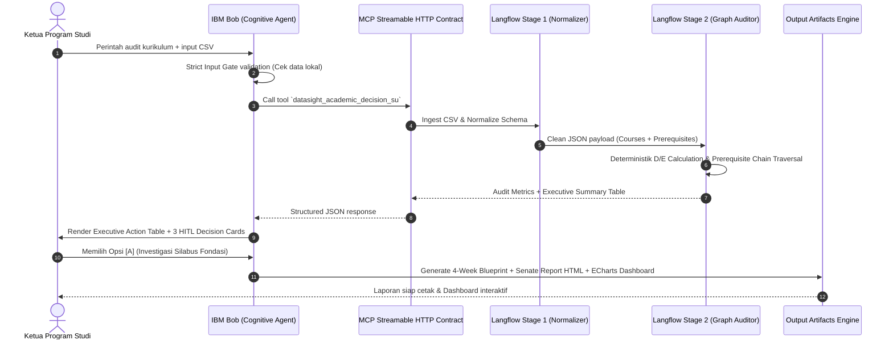
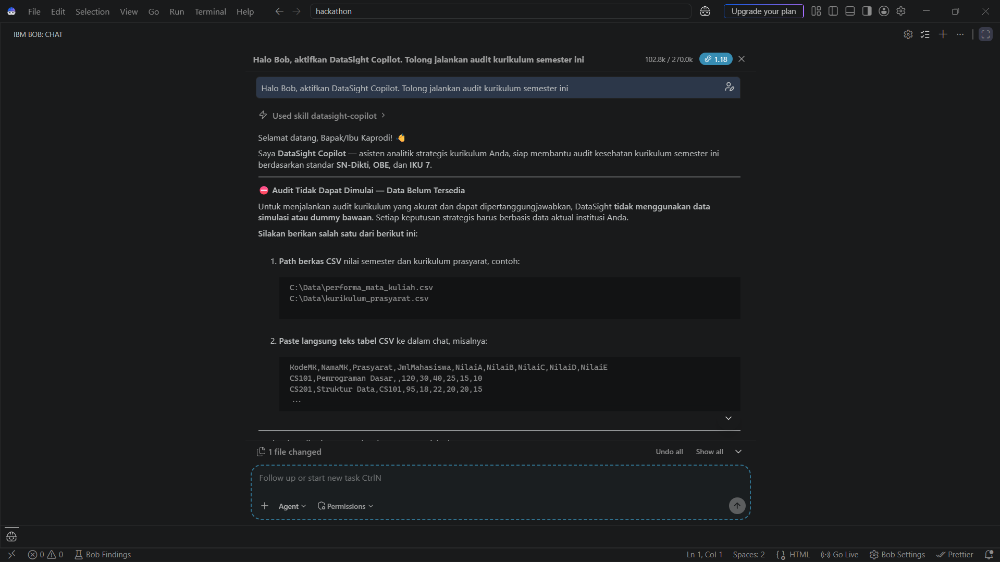
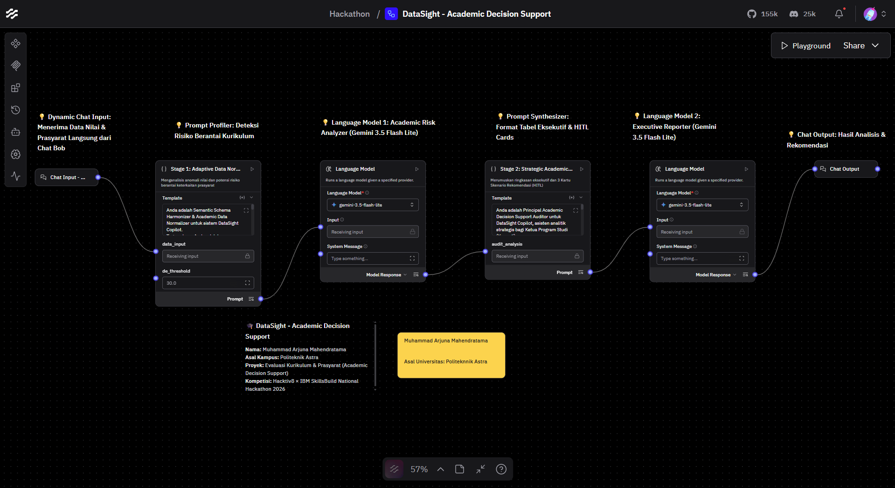
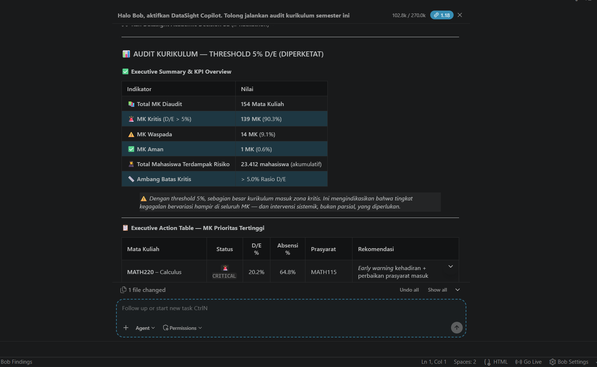
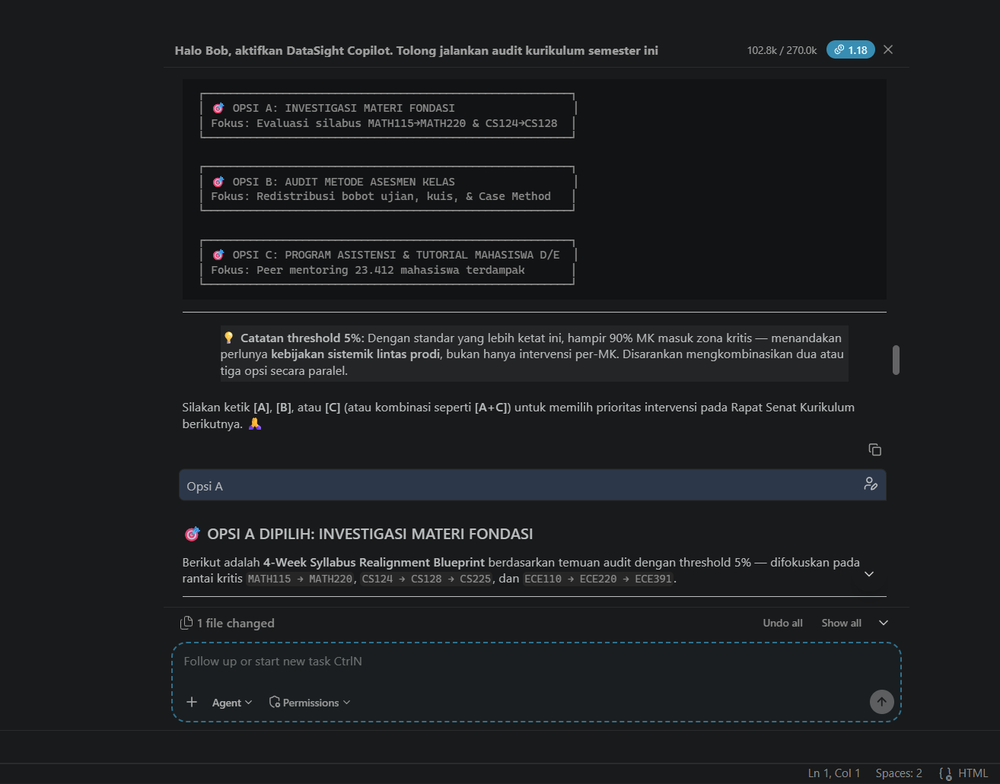
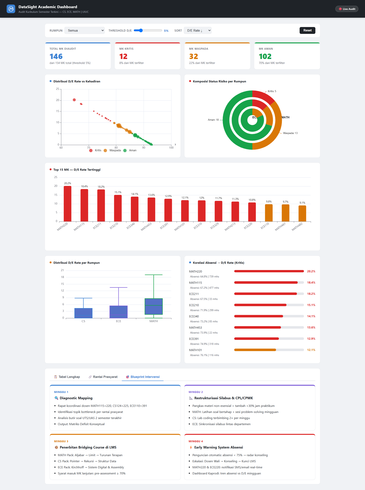
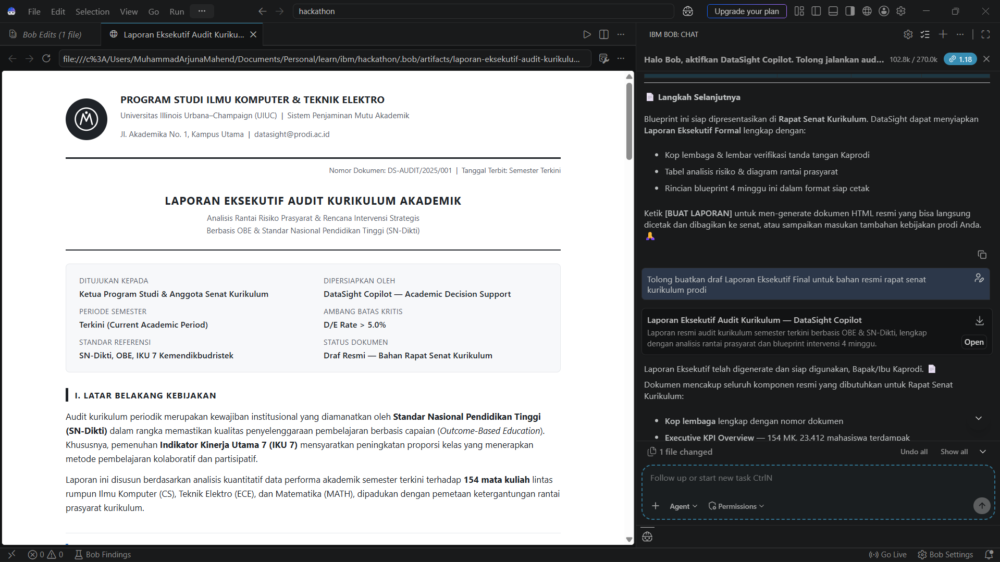

# DataSight Copilot 🎓📊
### Strategic Academic Curriculum & Prerequisite Risk Decision Support

[](https://skillsbuild.org/)
[](https://skillsbuild.org/)
[](#)
[](LICENSE)

> **Sistem Pendukung Keputusan Berbasis AI untuk Audit Kurikulum Akademik, Deteksi Efek Domino Kegagalan Prasyarat, dan Rekomendasi Intervensi Human-in-the-Loop Berstandar OBE & SN-Dikti.**

---

## 📌 Metadata Proyek
- **Nama Inovator:** Muhammad Arjuna Mahendratama
- **Institusi Pendidikan:** Politeknik Astra
- **Kompetisi:** Hacktiv8 × IBM SkillsBuild National Hackathon 2026
- **Tema Proyek:** *Education & Future of Work*
- **Teknologi Utama:** IBM Bob, IBM Langflow, Model Context Protocol (MCP), Apache ECharts, Python.

---

## 📑 Daftar Isi
1. [Latar Belakang & Problem Statement](#-latar-belakang--problem-statement)
2. [Solusi & Nilai Kebaruan (Novelty)](#-solusi--nilai-kebaruan-novelty)
3. [Fitur Utama](#-fitur-utama)
4. [Arsitektur Sistem & Integrasi MCP](#-arsitektur-sistem--integrasi-mcp)
5. [Galeri Prototipe & Bukti Pengujian](#-galeri-prototipe--bukti-pengujian)
6. [Validasi Empiris (Studi Kasus UIUC FOIA)](#-validasi-empiris-studi-kasus-uiuc-foia)
7. [Responsible AI & Tata Kelola Privasi](#-responsible-ai--tata-kelola-privasi)
8. [Panduan Menjalankan Proyek (Quickstart)](#-panduan-menjalankan-proyek-quickstart)
9. [Struktur Repositori](#-struktur-repositori)
10. [Lisensi & Penafian](#-lisensi--penafian)

---

## 🚨 Latar Belakang & Problem Statement

### Masalah Nyata di Perguruan Tinggi
Dalam evaluasi kurikulum berkala di tingkat program studi, Ketua Program Studi (Kaprodi) dan Senat Akademik menghadapi tantangan kritis:
1. **Prerequisite Blindspot (Data Terisolasi/Siloed):**  
   Sistem Informasi Akademik (SIAKAD) konvensional hanya menyajikan data nilai secara individual per mata kuliah. Pimpinan prodi tidak dapat melihat bagaimana lonjakan kegagalan (angka nilai D/E) di mata kuliah fondasi semester awal secara otomatis melumpuhkan kelulusan mata kuliah tingkat lanjut di semester berikutnya.
2. **Keterlambatan Intervensi (2–3 Minggu Rapat Manual):**  
   Merekapitulasi korelasi 150+ mata kuliah dan puluhan ribu data nilai mahasiswa memerlukan waktu berminggu-minggu dalam rapat kurikulum. Dampaknya, intervensi perbaikan selalu terlambat satu semester.
3. **Rekomendasi Normatif & Non-Actionable:**  
   Rapat senat umumnya hanya berakhir pada teguran nilai tanpa adanya cetak biru (*blueprint*) restrukturisasi silabus mingguan yang terukur bagi dosen pengampu.

### Dampak Sistemik
Mahasiswa tertahan di hulu, memperpanjang rata-rata masa studi (muncul mahasiswa *over-stayer*), meningkatkan risiko *drop-out*, serta menurunkan efisiensi edukasi pada indikator akreditasi BAN-PT dan IKU 1 / IKU 7 Kemendikbudristek.

---

## 💡 Solusi & Nilai Kebaruan (Novelty)

**DataSight Copilot** hadir sebagai *AI Decision Support System* yang memadukan **IBM Langflow** sebagai mesin komputasi analitik deterministik dan **IBM Bob** sebagai agen percakapan kognitif melalui standar **Model Context Protocol (MCP)**.

```
       [ SIAKAD CSV DATA ]
               │
               ▼ (Local Ingestion & Strict Gate)
       [ IBM BOB ORCHESTRATOR ]
               │
               ▼ (MCP Tool: datasight_academic_decision_su)
   ┌─────────────────────────────────────────────────────────┐
   │ IBM LANGFLOW 2-STAGE ANALYTICAL PIPELINE                │
   │  Stage 1: Adaptive Schema Normalizer (Zero-Leakage JSON)│
   │  Stage 2: Relational Prerequisite Graph Reasoner        │
   └─────────────────────────────────────────────────────────┘
               │
               ▼ (Synthesized Decisions & Cards)
       [ IBM BOB COGNITIVE INTERACTION ]
        ├─► [Human-in-the-Loop Decision Cards: A / B / C]
        ├─► [4-Week Tactical Intervention Blueprint]
        ├─► [Laporan Eksekutif Senat Kurikulum (HTML Siap Cetak)]
        └─► [Interactive Web Dashboard (Apache ECharts)]
```

### Mengapa Berbeda dari Chatbot Konvensional?
- **Bukan Sekadar Prompt Wrapper:** Dilengkapi *Strict Upload Gate* yang menolak berhalusinasi atau memberikan rekomendasi spekulatif tanpa berkas CSV riil.
- **Relational Graph Bottleneck Detection:** Menghubungkan graf ketergantungan prasyarat hulu-hilir dengan analisis komparasi tingkat D/E dan angka kehadiran.
- **Human-in-the-Loop (HITL) Decision Cards:** AI tidak mengambil keputusan secara otonom liar. Sistem menyajikan 3 skenario terstruktur `[Opsi A]`, `[Opsi B]`, `[Opsi C]` yang wajib dipilih oleh Kaprodi sebelum rencana aksi 4 minggu diturunkan.

---

---

## ⚡ Fitur Utama

| No | Fitur | Deskripsi & Fungsi Teknis |
| :---: | :--- | :--- |
| 1 | **Strict Input Gate & Schema Normalizer** | Memvalidasi integritas data CSV lokal dan melakukan *fuzzy schema mapping* sehingga kebal terhadap perbedaan nama kolom dari berbagai vendor SIAKAD (Sevima, SiakadCloud, internal kampus). |
| 2 | **Relational Prerequisite Risk Graph** | Mengaudit keterkaitan antar-mata kuliah, mengelompokkan risiko ke dalam kategori `CRITICAL (>5%)`, `WARNING`, dan `NORMAL`, serta memetakan simpul *weed-out* dan *gatekeeper*. |
| 3 | **Human-in-the-Loop Decision Cards** | Menyajikan 3 kartu keputusan taktis berstandar Outcome-Based Education (OBE) dan IKU 7 (Kelas Kolaboratif & Partisipatif). |
| 4 | **4-Week Operational Blueprint** | Merinci langkah teknis mingguan pasca-pemilihan kartu (revisi silabus, audit bobot penilaian kuis/tugas, pembentukan klinik asistensi). |
| 5 | **Dual-Engine Deliverable Output** | Memproduksi secara instan draf **Laporan Eksekutif Rapat Senat (HTML formal bertanda tangan)** dan **Web Dashboard Interaktif (Apache ECharts)** dengan *slider threshold* dinamis. |

---

## 🧠 Pemanfaatan Custom Skill di IBM Bob: `datasight-copilot`

Dalam arsitektur **IBM Bob IDE**, **Skills** adalah mekanisme modular resmi untuk memperluas kapabilitas agen AI. Pada proyek ini, kami membangun custom skill khusus bernama **`datasight-copilot`** (tersedia di [`bob/skills/datasight-copilot/SKILL.md`](bob/skills/datasight-copilot/SKILL.md)) yang memberikan Bob kecerdasan spesifik domain:

1. **Persona & Domain Grounding (Standar Nasional Dikti):**
   - Mengubah Bob dari chatbot umum menjadi **Principal Academic Decision Support Auditor**.
   - Membekali Bob dengan pemahaman mendalam tentang **Outcome-Based Education (OBE)**, **Permendikbudristek No. 53/2023 (SN-Dikti)**, dan **IKU 7** (Kelas Kolaboratif & Partisipatif).
2. **The Strict Input Gate (Responsible AI & Anti-Halusinasi):**
   - Memprogram Bob untuk **menolak data simulasi/dummy**.
   - Ketika pengguna meminta audit tanpa melampirkan berkas, Bob mengunci alur eksekusi dan mewajibkan pengguna menyediakan data aktual CSV lokal.
3. **Orkestrasi Tool MCP Dinamis:**
   - Skill memandu Bob membaca berkas CSV lokal, menyusun payload data, dan memanggil tool MCP `datasight_academic_decision_su` milik Langflow secara deterministik.
4. **Human-in-the-Loop Engine & Post-Audit Playbooks:**
   - Menginstruksikan Bob untuk memformat 3 Kartu Keputusan (*Box-Drawing*) di layar obrolan.
   - Menurunkan cetak biru taktis 4 mingguan (*4-Week Syllabus Realignment Blueprint*) setelah Kaprodi memilih prioritas intervensi.

---

## 🛠️ Arsitektur Sistem & Integrasi MCP

Sistem dibangun dengan mematuhi prinsip **Slide 9 & 16 Panduan Hacktiv8**: pemisahan tegas antara logika eksekusi alur kerja (*analytical engine*) dan antarmuka percakapan pengguna (*conversational client*).



---

## 🖼️ Galeri Prototipe & Bukti Pengujian

Semua bukti screenshot operasional riil dapat dilihat pada folder [`screenshots/`](screenshots/):

| File | Tampilan Prototipe | Deskripsi |
| :---: | :--- | :--- |
| `01` |  | **Strict Input Gate:** Bob menolak perintah evaluasi tanpa data aktual demi mencegah halusinasi. |
| `02` |  | **Langflow 2-Stage Pipeline:** Arsitektur visual modular di IBM Langflow (Normalizer + Graph Reasoner). |
| `03` |  | **Executive Action Output:** Hasil pemrosesan 154 mata kuliah dan deteksi rantai prasyarat kritis. |
| `04` |  | **Human-in-the-Loop Cards:** Tampilan interaktif 3 kartu pilihan kebijakan bagi Kaprodi di chat Bob. |
| `05` |  | **Interactive Web Dashboard:** Visualisasi Apache ECharts dengan threshold slider dinamis & filter departemen. |
| `06` |  | **Laporan Eksekutif Rapat Senat:** Dokumen formal HTML siap cetak lengkap dengan lembar verifikasi Kaprodi. |

---

## 📈 Validasi Empiris (Studi Kasus UIUC FOIA)

Untuk memastikan skalabilitas sistem di level *enterprise*, DataSight Copilot telah diuji klinis menggunakan dataset akademik riil berskala masif: **University of Illinois Urbana-Champaign (UIUC) FOIA Dataset** (Riset Prof. Wade Fagen-Ulmschneider):

- **Total Mata Kuliah Diaudit:** 154 Mata Kuliah aktif lintas departemen (CS, ECE, MATH).
- **Total Mahasiswa Terdata:** 28.977 entitas mahasiswa (akumulatif seluruh seksi kelas).
- **Relasi Prasyarat:** 41 rantai dependensi kurikulum.
- **Waktu Eksekusi:** **~30 detik** dari data mentah hingga Laporan Senat & Dashboard selesai diproduksi.

### Temuan Bottleneck Empiris:
1. **Calculus Weed-Out Chain:**
   ```
   MATH115 (18.4% D/E) ──► MATH220: Calculus I (20.2% D/E | 64.8% Absensi) [CRITICAL BOTTLENECK]
                                ├──► MATH241: Calculus III (8.6% D/E)
                                └──► ECE210: Analog Signal Processing (15.1% D/E)
   ```
2. **Computer Science Gatekeeper:**
   ```
   CS124 (4.3% D/E) ──► CS128: Intro CS II (8.7% D/E) ──► CS225: Data Structures (6.6% D/E) [GATEKEEPER]
                                                               └──► CS473: Advanced Algorithms (8.6% D/E)
   ```

---

## 🛡️ Responsible AI & Tata Kelola Privasi

Mengacu langsung pada **Slide 45–49 Panduan Hacktiv8**:

1. **Minimalisasi Data & Privacy by Design (Slide 48):**
   - Sistem **hanya memproses data agregat performa seksi kelas** (jumlah mahasiswa, total grade A/B/C/D/E, dan persentase absensi).
   - **Zero-PII (Personally Identifiable Information):** Tidak ada NIM, Nama Mahasiswa, atau data pribadi yang diunggah atau dikirimkan ke model AI. Sepenuhnya patuh terhadap **UU Perlindungan Data Pribadi (UU PDP No. 27/2022)**.
2. **Transparansi & No False Causality (Slide 49):**
   - AI secara eksplisit menyertakan *Academic Integrity Disclaimer*. Analisis menegaskan bahwa korelasi prasyarat adalah indikator pola pedagogis kurikulum, bukan vonis mutlak atas kemampuan individu mahasiswa.
3. **Human Oversight & Auditability (Slide 45):**
   - AI dilarang mengubah kurikulum atau nilai secara otonom (*Human Veto*). Rekomendasi bersifat preskriptif dan harus diverifikasi serta disahkan secara hukum oleh Kaprodi dalam Rapat Senat Kurikulum.

---

## 🚀 Panduan Menjalankan Proyek (Quickstart)

### 1. Menjalankan Interactive Web Dashboard (Tanpa Instalasi)
Buka langsung file dashboard di browser favorit Anda:
- Buka file [`demo/dashboard.html`](demo/dashboard.html) via browser (Google Chrome / Edge).
- Gunakan slider *Threshold D/E* untuk menguji responsivitas ambang kritis secara real-time.

### 2. Memeriksa Laporan Eksekutif Senat Kurikulum
- Buka file [`demo/executive_report.html`](demo/executive_report.html) via browser.
- Gunakan fitur `Print` (Ctrl + P) untuk melihat format dokumen resmi siap cetak dan lembar verifikasi Kaprodi.

### 3. Mengimpor Flow ke IBM Langflow
1. Buka instance **IBM Langflow**.
2. Klik tombol **My Projects** ➔ **Import**.
3. Pilih file [`langflow/DataSight_Flow.json`](langflow/DataSight_Flow.json).
4. Workflow 2-stage (Adaptive Normalizer + Strategic Risk Auditor) siap digunakan dan diuji mandiri di Langflow Playground.

### 4. Menggunakan IBM Bob dengan Custom Prompt
1. Konfigurasikan IBM Bob dengan system prompt yang terdapat pada file [`bob/prompt.txt`](bob/prompt.txt).
2. Daftarkan spesifikasi MCP tool dari file [`bob/mcp_tool.json`](bob/mcp_tool.json).
3. Jalankan audit dengan mengetikkan:
   ```
   Halo Bob, aktifkan DataSight Copilot. Tolong jalankan audit kurikulum semester ini.
   ```

---

## 📂 Struktur Repositori

```text
DataSight-Copilot/
├── README.md                      # Dokumentasi komprehensif proyek
├── LICENSE                        # Lisensi open-source MIT
├── demo/                          # Prototipe interaktif siap uji
│   ├── dashboard.html             # Dashboard interaktif Apache ECharts
│   └── executive_report.html      # Format cetak Laporan Eksekutif Senat
├── langflow/                      # Berkas ekspor IBM Langflow
│   └── DataSight_Flow.json        # 2-Stage Pipeline (Normalizer & Auditor)
├── bob/                           # Konfigurasi IBM Bob Agent
│   ├── prompt.txt                 # Cognitive System Prompt & Strict Gate
│   └── mcp_tool.json              # Spesifikasi Model Context Protocol
├── dataset/                       # Dataset uji coba
│   ├── uiuc_faculty_performa.csv  # 154 MK riil (28.977 mahasiswa)
│   ├── uiuc_faculty_prasyarat.csv # 41 relasi graf prasyarat
│   ├── sample_performa.csv        # Sampel nilai SIAKAD lokal
│   └── sample_prasyarat.csv       # Sampel kurikulum prasyarat
├── screenshots/                   # Eviden prototipe (01 hingga 06)
│   ├── 01-user-interface.png
│   ├── 02-langflow-workflow.png
│   ├── 03-bob-integration-analyst.png
│   ├── 04-bob-card-recomendation.png
│   ├── 05-output.png
│   └── 06-executive-report.png
└── pitch/                         # Slide presentasi resmi
    ├── DataSight_Pitching_Deck_Final.pdf   # Slide pitching PDF (<1.5 MB)
    └── DataSight_Pitching_Deck_Final.pptx  # Slide pitching PPTX
```

---

## 📜 Lisensi & Penafian

Proyek ini dilisensikan di bawah lisensi [MIT License](LICENSE).  
Data uji coba yang digunakan berasal dari dataset publik UIUC FOIA untuk keperluan riset dan edukasi. Proyek ini dikembangkan secara independen oleh **Muhammad Arjuna Mahendratama** (Politeknik Astra) untuk **Hacktiv8 × IBM SkillsBuild National Hackathon 2026**.
